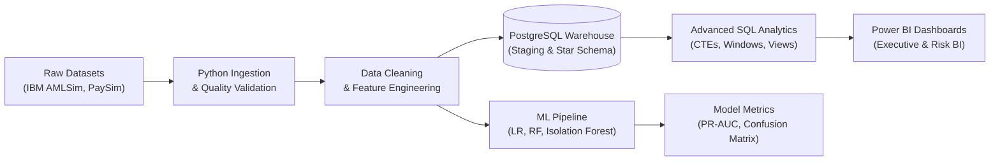

# FinTrace 360: Financial Transaction Intelligence & Risk Analytics

[](LICENSE)
[](https://www.python.org/)
[](https://www.postgresql.org/)
[](https://powerbi.microsoft.com/)
[](PROJECT_STATUS.md)

---

## 1. Executive Summary

**FinTrace 360** is an industry-inspired financial data analytics and risk intelligence platform engineered to simulate real-world financial compliance, AML (Anti-Money Laundering) transaction monitoring, and fraud detection workflows.

The project demonstrates end-to-end competencies across **Data Analytics (80%)**, **Relational Database & SQL Engineering**, **Business Intelligence (Power BI)**, and **Applied Machine Learning (20%)**.

### Strategic Architecture Modes:
- **Gate 1 — Global Demo / Portfolio Mode (Active Scope):** Utilizes publicly accessible and synthetic financial datasets (IBM AMLSim, PaySim, IEEE-CIS) to demonstrate banking transaction intelligence, money flow graphs, risk indicators, and supervised/unsupervised machine learning without using confidential bank data.
- **Gate 2 — Bank / Organization Mode (Future Roadmap):** Conceptual architecture enabling authorized institutions to securely ingest their internal transactional feeds with tenant isolation, TLS 1.3 encryption, and compliance-grade audit trails.

> **Data Disclosure & Ethics Notice:** All data utilized in Gate 1 is synthetic or anonymized public benchmark data. No proprietary, confidential, or real customer banking records are used. Simulated bank identifiers and account numbers are strictly for demonstration purposes.

---

## 2. Business Problem & Analytical Objectives

Financial institutions process millions of daily transactions across diverse payment rails. Detecting suspicious activity, structuring (smurfing), layering, and fraud while minimizing false positives requires rigorous analytical pipelines.

FinTrace 360 answers 10 core business and compliance questions:
1. What is the total volume, gross value, and temporal trajectory of transactions?
2. Which accounts exhibit anomalous velocity or transaction counts?
3. What is the distribution and risk profile across distinct transaction types?
4. Which behavioral patterns correlate most strongly with AML alerts?
5. How does transaction volume vary by bank and operational time window?
6. What network topologies and counterparty relationships characterize money flows?
7. How can we segment high-value transactions vs. rapid low-value structuring?
8. How can exploratory data analysis distinguish benign outliers from suspicious patterns?
9. How well can machine learning models predict labeled suspicious activity using Precision-Recall trade-offs?
10. What concrete recommendations can compliance teams derive from transaction intelligence?

---

## 3. Technology Stack

| Layer | Technologies |
|:---|:---|
| **Programming & Data Ingestion** | Python 3.14, Pandas, NumPy, Scipy |
| **Data Quality & Feature Engineering** | Pandas, Scikit-learn, Custom Validation Pipelines |
| **Relational Database & SQL** | PostgreSQL 18.4, SQLAlchemy, Psycopg2, Advanced SQL (CTEs, Window Functions) |
| **Business Intelligence** | Microsoft Power BI Desktop, DAX, Power Query |
| **Machine Learning (20%)** | Scikit-learn (Logistic Regression, Random Forest, Isolation Forest), XGBoost |
| **Data Visualization & Graphs** | Matplotlib, Seaborn, Plotly, NetworkX |
| **Version Control & Docs** | Git, Markdown, Mermaid Architecture Diagrams |

---

## 4. End-to-End System Pipeline



---

## 5. Dataset Governance & Strategy

The project separates distinct analytical problems across three recognized datasets:
1. **IBM AMLSim (Primary):** Synthetic agent-based banking network modeling anti-money laundering typologies (fan-out, fan-in, cycle, scatter-gather) across simulated bank accounts.
2. **PaySim (Secondary):** Synthetic mobile money transfer transactions modeling fraud scenarios across 6+ million records.
3. **IEEE-CIS Fraud Detection (Secondary):** Large-scale online card payment transactions analyzed via memory-efficient chunking.

---

## 6. Project Structure

```
FinTrace360/
├── data/
│   ├── raw/ (amlsim, paysim, ieee_cis)
│   ├── processed/
│   └── sample/
├── notebooks/
├── src/
│   ├── config/
│   ├── ingestion/
│   ├── validation/
│   ├── cleaning/
│   ├── analytics/
│   ├── features/
│   ├── database/
│   ├── ml/
│   └── utils/
├── sql/
├── powerbi/
├── models/
├── outputs/ (figures, metrics, reports)
├── reports/
├── docs/
├── tests/
├── .gitignore
├── requirements.txt
├── PROJECT_STATUS.md
└── LICENSE
```

---

## 7. Execution Status & Next Steps

See [PROJECT_STATUS.md](file:///D:/FinTrace%20360/PROJECT_STATUS.md) for live phase tracking.
