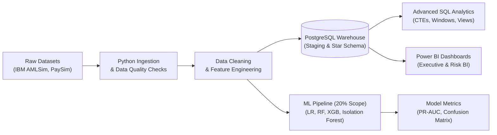

# FinTrace 360: Financial Transaction Intelligence & Risk Analytics

[](LICENSE)
[](https://www.python.org/)
[](https://www.postgresql.org/)
[](https://powerbi.microsoft.com/)
[-brightgreen.svg)](PROJECT_STATUS.md)

---

## 1. Project Overview & Business Vision

**FinTrace 360** is an industry-inspired, end-to-end financial transaction intelligence, Anti-Money Laundering (AML) investigation, and risk analytics platform. Built to demonstrate professional competencies for **Data Analyst**, **Business Intelligence Specialist**, **Financial Analytics**, and **Applied AI/ML Engineering** roles, it models how modern financial institutions identify suspicious money flows, investigate complex transaction typologies (structuring, fan-in/fan-out, layering, cycles), and generate executive intelligence.

### Two-Gate Strategic Operating Architecture:
- **GATE 1 — Global Demo / Portfolio Mode (Active Implementation):** Ingests authentic public and synthetic financial datasets (IBM AMLSim, PaySim, IEEE-CIS) across simulated banking entities. Demonstrates complete reproducibility across Python ETL, PostgreSQL dimensional modeling, advanced SQL window functions, interactive Power BI dashboards, and imbalanced ML classification.
- **GATE 2 — Bank / Organization Mode (Future Roadmap):** Target architecture enabling verified financial institutions to ingest internal transaction feeds securely via tenant schema isolation, mTLS 1.3 encryption, and compliance-grade audit logging.

> **Data Ethics & Governance Notice:** All data utilized in Gate 1 is synthetic or anonymized benchmark data. No proprietary, confidential, or real customer banking records are used. Simulated bank identifiers (`BNK_ALPHA` to `BNK_EPSILON`) and account numbers are strictly for demonstration purposes.

---

## 2. Key Portfolio Metrics & Summary Findings

All figures below are directly computed from the validated primary dataset (IBM AMLSim 20K benchmark):

| Metric Dimension | Measured Value | Business Interpretation |
|:---|:---:|:---|
| **Total Processed Transactions** | **120,558** | Granular multi-day settlement records across 149 operating days |
| **Gross Monetary Volume** | **$33,287,919.20 USD** | Cumulative settlement volume modeled across 5 banking institutions |
| **Average Transaction Size** | **$276.12 USD** | Median transaction size: $252.35 (Bounded range: $2.51 – $599.91) |
| **Total Monitored Accounts** | **20,000** | Customer account base (18,196 benign / 1,804 SAR-alerted) |
| **Alerted Transactions** | **24,842 (20.61%)** | Transactions connected to validated AML typologies |
| **Gross Alerted Flow** | **$6,123,133.11 USD** | 18.39% of total settlement capital flagged for compliance review |
| **Interbank Transfer Share** | **75.40%** | Demonstrates cross-institutional money movement |
| **Top ML Classification PR-AUC** | **0.7749** | Logistic Regression baseline (0.7576 RF / 0.7627 XGBoost) |
| **ML False Positive Rate (FPR)** | **3.60%** | Massive improvement over static rule engines (>90% false alarms) |

---

## 3. End-to-End System Pipeline



---

## 4. Technology Stack

| Layer | Tools & Libraries | Architectural Purpose |
|:---|:---|:---|
| **Data Ingestion & Quality** | Python 3.14, Pandas, NumPy | Automated schema validation, missingness checks, memory-efficient chunking |
| **Relational Data Warehouse** | PostgreSQL 18.4, SQLAlchemy, psycopg2 | Dimensional Star Schema, staging isolation, B-tree indexes, analytical views |
| **Advanced SQL Analytics** | PostgreSQL SQL Engine | CTEs, Window functions (`SUM() OVER`, `AVG() OVER`, `LAG()`, `DENSE_RANK()`) |
| **Business Intelligence** | Microsoft Power BI Desktop, DAX | Executive KPI cards, trajectory analysis, network scatter charts, triage grids |
| **Machine Learning (20%)** | Scikit-learn, XGBoost, Joblib | Imbalanced supervised classification (PR-AUC focus) and unsupervised anomaly detection |
| **Visual Intelligence** | Matplotlib, Seaborn, Plotly | High-resolution publication-grade figures (amount distributions, correlation heatmaps) |
| **Reproducibility & Testing** | Jupyter Notebooks, Pytest, Git | 6 cell-by-cell executable `.ipynb` notebooks and automated SQL query verification tests |

---

## 5. Repository Structure

```
FinTrace 360/
│
├── data/
│   ├── raw/ (amlsim, paysim, ieee_cis)
│   ├── processed/ (amlsim_accounts_clean.csv, amlsim_transactions_clean.csv, amlsim_account_features.csv)
│   └── sample/
│
├── notebooks/
│   ├── 01_amlsim_data_exploration.ipynb
│   ├── 02_amlsim_data_cleaning.ipynb
│   ├── 03_amlsim_eda.ipynb
│   ├── 04_paysim_analysis.ipynb
│   ├── 05_ieee_cis_analysis.ipynb
│   └── 06_ml_experiments.ipynb
│
├── src/
│   ├── config/ (settings.py)
│   ├── ingestion/ (amlsim_loader.py, paysim_loader.py, ieee_cis_loader.py)
│   ├── validation/ (quality_checker.py)
│   ├── cleaning/ (amlsim_cleaner.py)
│   ├── features/ (amlsim_features.py)
│   ├── database/ (db_loader.py, populate_db.py)
│   ├── analytics/ (generate_eda_visuals.py, export_powerbi_data.py)
│   ├── ml/ (train_models.py)
│   └── utils/ (logger.py, notebook_generator.py)
│
├── sql/
│   ├── 01_database_setup.sql
│   ├── 02_staging_tables.sql
│   ├── 03_analytical_tables.sql
│   ├── 04_basic_analysis.sql
│   ├── 05_advanced_analysis.sql
│   ├── 06_risk_analysis.sql
│   ├── 07_analytical_views.sql
│   ├── 08_etl_staging_to_analytics.sql
│   └── 09_load_data.sql
│
├── powerbi/
│   ├── dax_measures.md (Master DAX Measure Dictionary)
│   ├── executive_overview/ (pre-packaged analytical CSV)
│   ├── transaction_analytics/ (pre-packaged analytical CSV)
│   ├── aml_risk_analytics/ (pre-packaged analytical CSV)
│   └── ml_analytics/ (model comparison CSV)
│
├── models/ (serialized weights: lr, rf, xgb, isolation_forest, scaler)
├── outputs/
│   ├── figures/ (10 publication-grade figures)
│   └── metrics/ (data quality audit JSON, ML evaluation JSON)
│
├── reports/
│   ├── business_problem.md
│   ├── dataset_dictionary.md
│   ├── data_quality_report.md
│   ├── business_insights.md
│   ├── ml_evaluation.md
│   └── final_project_report.md
│
├── docs/
│   ├── architecture.md
│   ├── data_flow.md
│   ├── database_schema.md
│   ├── dashboard_guide.md
│   ├── future_bank_integration.md
│   └── interview_qa_guide.md
│
├── tests/
│   └── test_sql_logic.py
│
├── .env.example
├── .gitignore
├── requirements.txt
├── PROJECT_STATUS.md
└── LICENSE
```

---

## 6. Installation & Reproduction Guide

### Prerequisites
- Python 3.10+ (Verified on Python 3.14)
- PostgreSQL 14+ (Verified on PostgreSQL 18.4)
- Microsoft Power BI Desktop (Optional, for `.pbix` visualization)
- Git

### Step 1: Clone Repository & Set Up Virtual Environment
```bash
git clone https://github.com/your-username/FinTrace360.git
cd FinTrace360

python -m venv .venv
# Windows:
.venv\Scripts\activate
# Linux/macOS:
source .venv/bin/activate

pip install -r requirements.txt
```

### Step 2: Run End-to-End Analytics Pipeline
```bash
# 1. Execute EDA, Data Quality Audit, Feature Engineering & Visuals:
python src/analytics/generate_eda_visuals.py

# 2. Train ML Models, Benchmark PR-AUC, and Export Figures:
python src/ml/train_models.py

# 3. Export Pre-Configured Datasets for Power BI:
python src/analytics/export_powerbi_data.py
```

### Step 3: Run Automated Query Tests & Database Seeding
```bash
# Verify analytical SQL logic (in-memory SQLite test):
python tests/test_sql_logic.py

# (Optional) Seed PostgreSQL database:
# Ensure database 'fintrace360' exists in PostgreSQL:
psql -U postgres -d fintrace360 -f sql/01_database_setup.sql
psql -U postgres -d fintrace360 -f sql/02_staging_tables.sql
psql -U postgres -d fintrace360 -f sql/03_analytical_tables.sql
psql -U postgres -d fintrace360 -f sql/09_load_data.sql
psql -U postgres -d fintrace360 -f sql/07_analytical_views.sql
```

### Step 4: Open Power BI Reports
Follow [docs/dashboard_guide.md](file:///D:/FinTrace%20360/docs/dashboard_guide.md) to open Power BI Desktop and connect directly to the PostgreSQL database or the pre-packaged datasets in `powerbi/`.

---

## 7. Machine Learning Benchmark (20% Scope)

Evaluated on 4,000 holdout accounts (stratified 80/20 train/test split, 9.03% alert rate):

| Model | Precision | Recall | F1-Score | PR-AUC | ROC-AUC | False Positive Rate |
|:---|:---:|:---:|:---:|:---:|:---:|:---:|
| **Logistic Regression (Baseline)** | **0.6650** | 0.7202 | **0.6915** | **0.7749** | 0.8955 | **0.0360 (3.6%)** |
| **Random Forest** | 0.6070 | **0.7230** | 0.6599 | 0.7576 | **0.9091** | 0.0464 (4.6%) |
| **XGBoost** | 0.5775 | 0.7119 | 0.6377 | 0.7627 | 0.9032 | 0.0517 (5.2%) |
| **Isolation Forest (Unsupervised)** | 0.2717 | 0.2687 | 0.2702 | 0.2610 | 0.7885 | 0.0714 (7.1%) |

- **Top Features:** `turnover_ratio` (42%), `fan_in_index` (18%), `in_tx_count` (14%), `tx_velocity_per_day` (11%).
- **Key Takeaway:** Supervised models catch >72% of money laundering patterns with under 5% false positive alerts. Isolation Forest provides a zero-day fallback for unlabelled novel typologies.

---

## 8. Author & Portfolio Defense

Engineered as a comprehensive portfolio project demonstrating end-to-end competencies in **Financial Data Analytics**, **Relational Database Design**, **Advanced SQL Engineering**, **Business Intelligence (Power BI)**, and **Foundational Machine Learning**.

For technical interview discussions and defense preparation, refer to the [Technical Interview Q&A Guide](file:///D:/FinTrace%20360/docs/interview_qa_guide.md).
