# FinTrace 360 — Architecture & System Design

## 1. System Vision & Two-Gate Architecture

FinTrace 360 is engineered as an enterprise-grade financial analytics and transaction intelligence platform with two strategic operating modes:

```mermaid
flowchart TD
    subgraph Gate1["GATE 1 — GLOBAL DEMO / PORTFOLIO MODE (ACTIVE)"]
        A1[Public / Synthetic Datasets] -->|IBM AMLSim, PaySim, IEEE-CIS| B1[Python Ingestion & Validation]
        B1 --> C1[Data Cleaning & Quality Checks]
        C1 --> D1[Feature Engineering & Enrichment]
        D1 --> E1[(PostgreSQL Analytical Warehouse)]
        E1 --> F1[SQL Analytics & Star Schema Views]
        F1 --> G1[Power BI Executive & Risk Dashboards]
        D1 --> H1[Baseline & Anomaly ML Models]
        H1 --> I1[Evaluation Metrics & PR-AUC Reports]
    end

    subgraph Gate2["GATE 2 — BANK / ORGANIZATION MODE (FUTURE ROADMAP)"]
        A2[Authorized Bank Core / Ingestion API] -->|Tenant Auth & TLS 1.3| B2[Tenant Ingestion Service]
        B2 --> C2[Bank Data Isolation / Tenant Schemas]
        C2 --> D2[(Isolated Bank DB Partition)]
        D2 --> E2[Automated Compliance & AML Reporting]
        D2 --> F2[Private ML Inference Engine]
        E2 --> G2[Role-Based BI Dashboards & Audit Trail]
    end

    style Gate1 fill:#e8f4fd,stroke:#1b72e8,stroke-width:2px
    style Gate2 fill:#f1f3f4,stroke:#5f6368,stroke-dasharray: 5 5
```

---

## 2. Gate 1 vs. Gate 2 Specification

| Architectural Dimension | Gate 1: Global Demo / Portfolio Mode | Gate 2: Bank / Organization Mode (Future Roadmap) |
|:---|:---|:---|
| **Data Provenance** | Public / Synthetic (IBM AMLSim, PaySim, IEEE-CIS) | Real authorized banking transactional feeds |
| **Data Disclosure** | Clearly labeled as simulated; no real bank data claims | Regulated banking data under NDA, SOC2, and banking compliance |
| **Tenancy Model** | Single analytical warehouse with source separation | Multi-tenant isolated schemas or separate database instances |
| **Ingestion Pipeline** | Batch Python CSV ingestion with validation scripts | Streaming (Kafka/Flink) or secure SFTP / REST ETL with TLS 1.3 |
| **Authentication & RBAC** | Local developer credentials, environment variables | Enterprise SSO (OAuth2 / OIDC), IAM, audit logging |
| **Machine Learning** | Offline training, PR-AUC benchmarking, Isolation Forest | Secure batch/real-time inference, model drift monitoring |
| **Reporting Target** | Power BI Desktop (.pbix), static figures, HTML/markdown | Power BI Service with Row-Level Security (RLS) & compliance exports |

---

## 3. Data Processing Pipeline (Gate 1 Implementation)

1. **Raw Ingestion Layer (`data/raw/`)**:
   - Preserves source datasets in their exact raw state without mutation.
   - Separate subdirectories for `amlsim/`, `paysim/`, and `ieee_cis/`.

2. **Validation & Quality Assurance (`src/validation/`)**:
   - Schema enforcement, null-check audits, duplicate detection, range checks.
   - Generates automated data quality reports.

3. **Data Cleaning & Transformation (`src/cleaning/`)**:
   - Timestamp parsing, type casting, handling anomalies, categorical standardization.
   - Exports clean datasets to `data/processed/`.

4. **Relational Database & SQL Layer (`sql/`, `src/database/`)**:
   - Staging tables mirror cleaned files directly.
   - Analytical star schema with Fact tables (`fact_transactions`, `fact_alerts`) and Dimension tables (`dim_accounts`, `dim_banks`, `dim_dates`, `dim_transaction_types`).
   - SQL analytical views for Power BI direct import and fast analytical queries.

5. **Business Intelligence Layer (`powerbi/`)**:
   - Executive Financial Overview Dashboard.
   - Transaction Behaviour & Velocity Analytics Dashboard.
   - AML Risk & Alert Investigation Dashboard.
   - ML Evaluation & Model Diagnostics Dashboard.

6. **Machine Learning Layer (`src/ml/`, `models/`)**:
   - Supervised classification: Logistic Regression, Random Forest, XGBoost.
   - Unsupervised anomaly detection: Isolation Forest.
   - Strict time-based validation splits to prevent future data leakage.
   - Metric focus: Precision-Recall AUC (PR-AUC), Recall at 1% FPR, Confusion Matrices.
