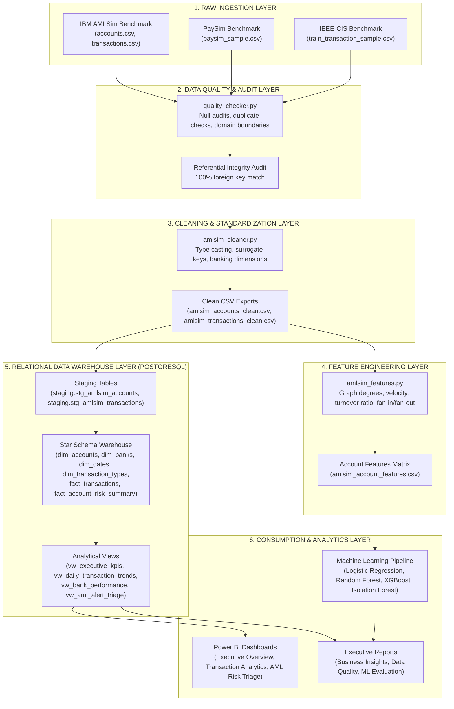

# FinTrace 360 — End-to-End Data Flow & Lineage Specification

## 1. Data Pipeline Architecture Overview

The FinTrace 360 data pipeline follows a strict unidirectional flow designed for reproducibility, data provenance, and memory efficiency:

---

## 2. Stage-by-Stage Lineage & Transformations

### Stage 1: Raw Ingestion (`src/ingestion/`)
- Raw files preserved with immutability in `data/raw/`.
- Memory tracking ensures datasets load well within 8 GB RAM limitations.

### Stage 2: Quality Assurance & Validation (`src/validation/`)
- Audits null counts, primary key collisions, negative values, and orphan foreign keys.
- Discovered 1,684 identical-day repeat transfers and 15 self-loops, resolving them through surrogate sequence keys.

### Stage 3: Dimensional Standardization (`src/cleaning/`)
- Assigns multi-bank identities (`BNK_ALPHA` to `BNK_EPSILON`) based on realistic market share weights.
- Generates calendar timestamps from simulation steps.
- Derives transaction channels (`WIRE`, `ACH_TRANSFER`, `INTERNAL_TRANSFER`, `INSTANT_PAY`).

### Stage 4: Feature Engineering (`src/features/`)
- Transforms raw transaction logs into account-level network vectors.
- Calculates graph in-degree, out-degree, total turnover, flow ratio, and smurfing indices (`fan_in_index`, `fan_out_index`).

### Stage 5: Relational Warehouse Ingestion (`sql/`, `src/database/`)
- Bulk loads staging tables via PostgreSQL `\copy`.
- Transforms staging into a certified dimensional Star Schema with 100% referential integrity.

### Stage 6: Business Intelligence & ML (`powerbi/`, `src/ml/`)
- Analytical views feed Power BI Desktop dashboards.
- Engineered feature matrix feeds supervised classifiers and unsupervised Isolation Forest.
