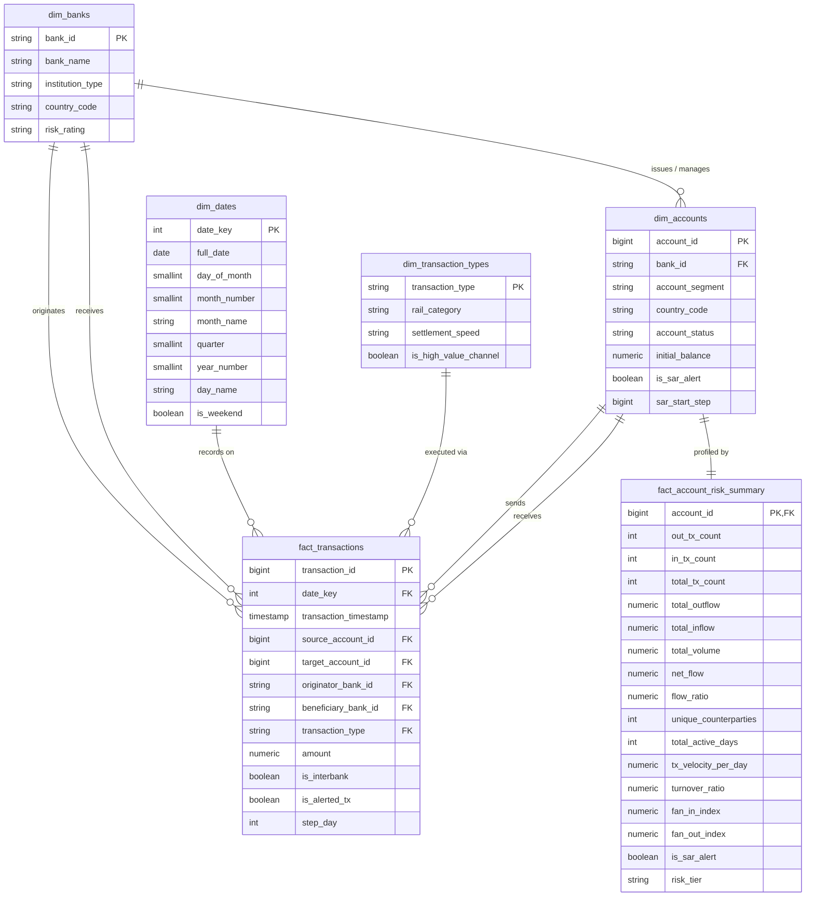

# FinTrace 360 — Relational Database Schema & Data Warehouse Design

## 1. Dimensional Star Schema Architecture

FinTrace 360 utilizes a dimensional Star Schema warehouse hosted in PostgreSQL, cleanly separating the `staging` and `analytics` schemas:

---

## 2. Table Specifications & Cardinalities

### 2.1 Dimension Tables
- **`analytics.dim_banks` (5 Rows):** Simulated partner banking institutions (`BNK_ALPHA` to `BNK_EPSILON`) with institution classifications (Tier 1 Commercial, Merchant, Private Wealth).
- **`analytics.dim_dates` (365 Rows):** Date dimension covering calendar dimensions, business days vs weekends, and month/quarter aggregations.
- **`analytics.dim_transaction_types` (4 Rows):** Payment rails (`WIRE`, `ACH_TRANSFER`, `INTERNAL_TRANSFER`, `INSTANT_PAY`) mapped to settlement mechanisms.
- **`analytics.dim_accounts` (20,000 Rows):** Dimension entity for customer accounts with initial balances, segments, and baseline AML alert flags.

### 2.2 Fact Tables
- **`analytics.fact_transactions` (120,558 Rows):** Granular transaction event table containing exact payment amounts, timestamps, counterparty account references, and cross-bank indicators.
- **`analytics.fact_account_risk_summary` (20,000 Rows):** Pre-aggregated behavioral fact table capturing cumulative turnover, velocity, network fan-in/fan-out ratios, and multi-tier risk ratings (`CRITICAL`, `HIGH`, `MEDIUM`, `LOW`).

---

## 3. Indexing Strategy & Performance Optimization

To deliver sub-second query response times across analytical CTEs and Power BI import queries, specific composite and B-tree indexes are implemented:
- `idx_fact_tx_date` on `(date_key)`: Optimizes time-series filtering and rolling 7-day window calculations.
- `idx_fact_tx_src` & `idx_fact_tx_dst` on `(source_account_id)` and `(target_account_id)`: Enables instantaneous graph edge joins and counterparty corridor aggregations.
- `idx_fact_tx_alert` on `(is_alerted_tx)`: Accelerates compliance alert slicing and SAR volume filtering.
- `idx_fact_tx_amount` on `(amount)`: Powers ticket size segmentation and high-value wire analysis.
