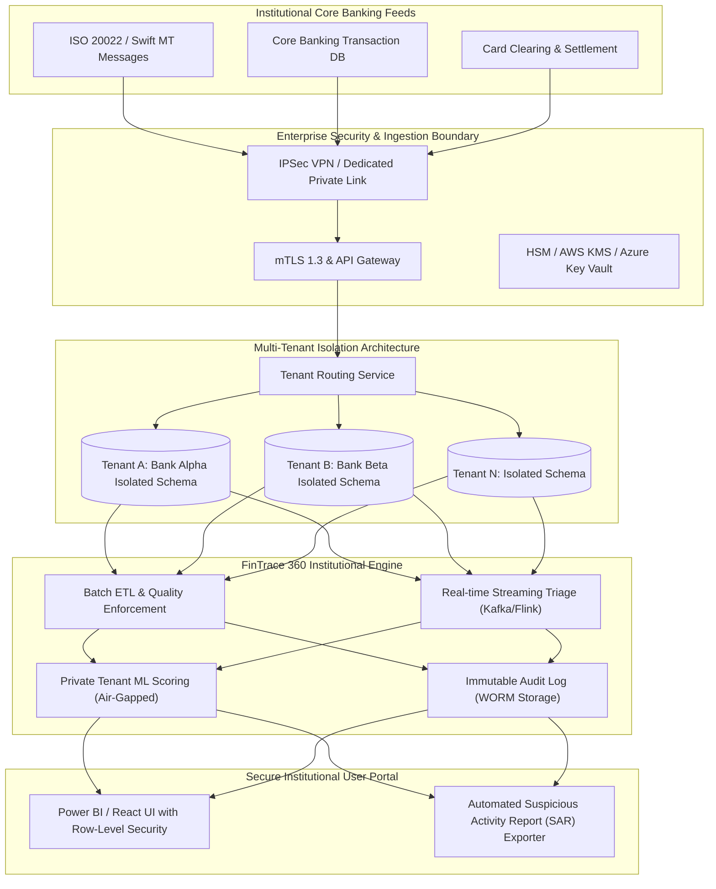

# Gate 2: Bank / Organization Mode — Future Architecture Roadmap

## 1. Architectural Overview

While Gate 1 delivers the portfolio and public demonstration capability using public/synthetic datasets, Gate 2 is the enterprise target architecture enabling production-ready, multi-tenant deployment for verified banking institutions.

---

## 2. Core Pillars of Gate 2

### 2.1 Multi-Tenant Data Isolation
- **Schema-per-Tenant Separation:** Each onboarded bank operates within an isolated PostgreSQL schema or separate database cluster. Cross-tenant queries are blocked at the connection and database engine layers.
- **Tenant Identification:** Every ingested transaction, alert, and account is strictly mapped to an authorized institutional identifier (`tenant_bank_id`).

### 2.2 Security, Privacy & Data Protection
- **Encryption Standards:** Full AES-256 encryption at rest (storage volumes and database tables) and TLS 1.3 in transit with mutual authentication (mTLS).
- **Zero Raw Secrets:** Cloud KMS (Key Management Service) or HashiCorp Vault for managing rotating database credentials, API tokens, and encryption keys.
- **Data Minimization & PII Masking:** Hashing or tokenization of sensitive Personally Identifiable Information (PII) like national identity numbers, exact residential addresses, and raw card PANs.

### 2.3 Role-Based Access Control (RBAC) & Auditability
- **Strict Role Separation:**
  - *Tier 1 Investigator:* View alerts, counterparty graphs, and transaction history within assigned jurisdiction.
  - *Compliance Officer / MLRO:* Approve or reject investigations, submit SARs to regulators, adjust rule thresholds.
  - *Data Engineer / Admin:* Monitor ingestion pipelines and system health without access to customer transaction content.
- **Immutable Audit Trails:** Every search, report export, alert triage decision, and threshold update is recorded in tamper-evident write-once-read-many (WORM) storage.

### 2.4 Production Disclaimer
Gate 2 is an architectural design specification and roadmap. FinTrace 360 Gate 1 makes no claim of production regulatory certification, live core banking connection, or actual bank data processing.
