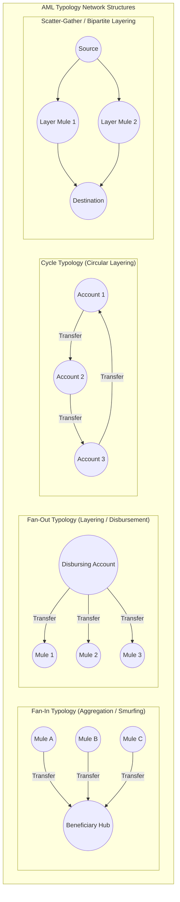

# FinTrace 360 — Data Dictionary & Schema Specification

## 1. Overview & Dataset Governance

**Dataset Name:** IBM AMLSim (Anti-Money Laundering Simulator Benchmark)  
**Source Repository:** [IBM/AMLSim](https://github.com/IBM/AMLSim)  
**Citation / Reference:** Suzumura & Kanezashi (IBM Research), *Anti-Money Laundering Datasets*, 2021.  
**Dataset Status:** Synthetic / Simulated Multi-Agent Financial Network.  
**Ethics & Disclosure:** All entities, account identifiers, balances, and transaction amounts are entirely simulated. No real customer identities or actual bank financial data are represented.

---

## 2. Primary Dataset Schema: `accounts` (`nodes.csv`)

Represents individual retail and commercial bank accounts in the simulated financial network.

| Column Name | Data Type | Nullable | Primary Key | Description | Example Values |
|:---|:---:|:---:|:---:|:---|:---|
| `nodeid` | `INTEGER` | No | Yes | Unique synthetic account identifier in the network. | `0`, `1`, `14730` |
| `isFraud` | `INTEGER` | No | No | Ground-truth AML risk flag. `1` if account participates in an alerted laundering typology; `0` otherwise. | `0`, `1` |
| `init_balance` | `FLOAT` | No | No | Initial opening balance in base currency (USD equivalent). | `184.44`, `250.31` |
| `fraudStep` | `INTEGER` | No | No | Discrete simulation step when fraudulent activity initiates. `-1` denotes benign/clean account; values `>= 1` denote step of first alerted pattern. | `-1`, `12`, `75` |

### Summary Statistics (`accounts`):
- **Total Records:** 20,000 accounts.
- **Benign Accounts (`isFraud = 0`):** 18,197 (90.98%).
- **Alerted Accounts (`isFraud = 1`):** 1,803 (9.02%).
- **Balance Range:** Min: \$100.04 | Median: \$250.31 | Mean: \$280.05 | Max: \$599.92.

---

## 3. Primary Dataset Schema: `transactions` (`transactions.csv`)

Represents directed monetary transfers between accounts across discrete time steps.

| Column Name | Data Type | Nullable | Foreign Key | Description | Example Values |
|:---|:---:|:---:|:---:|:---|:---|
| `transaction_id` | `INTEGER` | No | Yes (Synthetic) | Monotonically increasing unique transaction identifier. | `1`, `2`, `120558` |
| `sourceNodeId` | `INTEGER` | No | `accounts.nodeid` | Originator (sender) account ID. | `216`, `322` |
| `targetNodeId` | `INTEGER` | No | `accounts.nodeid` | Beneficiary (receiver) account ID. | `14730`, `5431` |
| `value` | `FLOAT` | No | No | Monetary amount transferred in base currency units. | `163.30`, `276.12` |
| `time` | `INTEGER` | No | No | Discrete simulation step (temporal indicator from step 1 to step 149). | `1`, `75`, `149` |

### Summary Statistics (`transactions`):
- **Total Transactions:** 120,558 records.
- **Gross Transaction Value:** \$33,288,919.10 USD.
- **Average Transaction Value:** \$276.12 USD (Std Dev: \$143.27).
- **Transaction Amount Range:** Min: \$2.51 | Median: \$252.35 | Max: \$599.91.
- **Simulation Horizon:** 149 discrete daily time steps.

---

## 4. AML Typology & Alert Taxonomy (`metadata.txt` & `schema_sample`)

The IBM AMLSim generator embeds canonical anti-money laundering structural typologies:

| Typology Code | Typology Name | Structural Signature | Primary Intent | Embedded in Benchmark |
|:---|:---|:---|:---|:---:|
| `fan_in` | Smurfing / Aggregation | Multiple originators funneling funds into a single centralized beneficiary. | Collecting illicit proceeds from dispersed collectors. | **Yes** (200 patterns) |
| `cycle` | Circular Laundering | A closed loop of $N$ accounts transferring funds cyclically before exit. | Layering to obscure the original audit trail. | **Yes** (200 patterns) |
| `fan_out` | Rapid Disbursement | Single account disbursing funds to multiple downstream accounts. | Quick cash-out / mule network funding. | Yes (in param files) |
| `scatter_gather` | Bipartite Multipath | Dispersing across intermediate accounts and reconverging at a destination. | Circumventing static single-hop velocity limits. | Yes (in param files) |

---

## 5. Secondary Datasets (Roadmap Preview)

### Dataset B: PaySim (Mobile Money)
- **Entities:** Synthetic mobile money transactions (`step`, `type`, `amount`, `nameOrig`, `oldbalanceOrg`, `newbalanceOrig`, `nameDest`, `oldbalanceDest`, `isFraud`, `isFlaggedFraud`).
- **Focus:** Mobile wallet fraud and account balance reconciliation anomalies.

### Dataset C: IEEE-CIS Fraud Detection
- **Entities:** E-commerce card transactions (`TransactionID`, `isFraud`, `TransactionDT`, `TransactionAmt`, `ProductCD`, `card1-6`, `addr1-2`, `dist1-2`, `P_emaildomain`, `R_emaildomain`).
- **Focus:** Complex identity, device, and card network features with high feature dimensionality.
