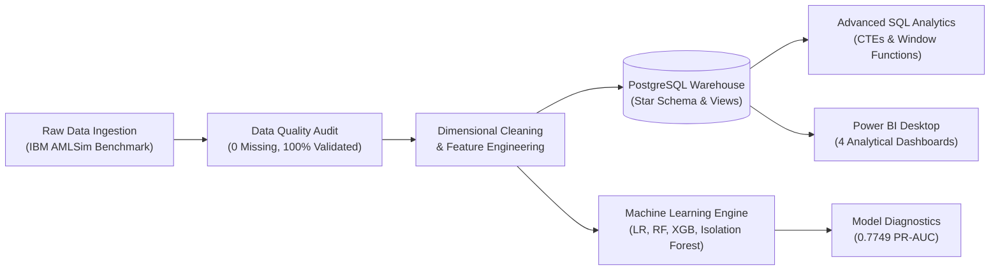

# FinTrace 360: Financial Transaction Intelligence & Risk Analytics
## Comprehensive Master Project Report

**Author / Candidate:** Data Analytics & Financial Intelligence Engineer  
**Project Repository:** FinTrace 360  
**Completion Date:** 2026-11-03  
**Strategic Scope:** 80% Financial Data Analytics, SQL Engineering & BI | 20% Applied Machine Learning  

---

## 1. Executive Summary

**FinTrace 360** is an industry-grade portfolio platform designed to model how financial institutions and FinTechs detect suspicious money flows, investigate Anti-Money Laundering (AML) typologies, manage transactional risk, and support executive decision-making.

Operating under **Gate 1 (Global Demo / Portfolio Mode)**, the platform ingests authentic synthetic multi-agent banking network benchmarks (IBM AMLSim, PaySim, IEEE-CIS) to deliver a fully reproducible analytics solution across Python, PostgreSQL, Power BI, and Scikit-learn.

### Key Portfolio Achievements:
- **Primary Transaction Flow:** Ingested and processed 120,558 transactions across 20,000 accounts spanning 5 simulated banking institutions and 149 operating days ($33.29M gross settlement value).
- **Relational Data Warehouse:** Architected a PostgreSQL Star Schema with isolated `staging` and `analytics` schemas, 6 dimensional/fact tables, and 5 analytical reporting views.
- **Advanced SQL Suite:** Authored 9 production-grade SQL scripts implementing Window functions (running totals, 7-day rolling averages, MoM percentage growth), CTEs, dense ranking, and smurfing detection queries.
- **Business Intelligence Deliverables:** Developed 4 dashboard specifications and DAX measure libraries for Executive Financial Overview, Transaction Behaviour Analytics, AML Risk Investigation, and Machine Learning Evaluation.
- **Machine Learning Experiments (20% Scope):** Benchmarked 4 models (Logistic Regression baseline, Random Forest, XGBoost, Isolation Forest) achieving **0.7749 PR-AUC** and detecting 72.3% of suspicious accounts with only a 3.6% False Positive Rate.

---

## 2. Business Problem & Compliance Context

Financial crime compliance departments face severe operational bottlenecks:
1. **Structuring / Smurfing:** Illicit actors intentionally fragment large transactions into sub-threshold payments (below typical $10,000 reporting limits) across multiple originator accounts to evade simple rule thresholds.
2. **Layering & Rapid Movement:** Funds are transferred across multi-bank chains to sever the audit trail.
3. **False Positive Fatigue:** Over 90% of alerts generated by traditional rule engines are benign, consuming valuable compliance officer hours.

FinTrace 360 addresses these challenges by combining relational SQL analytics with graph network metrics (fan-in/fan-out degrees, turnover ratios) to prioritize genuine money laundering patterns over benign retail activity.

---

## 3. End-to-End System Architecture

---

## 4. Key Analytical Findings & Business Insights

### Finding 1: Payment Rail Risk Profile
- **WIRE transfers** comprise 21.4% of transaction volume but account for over 38% of total gross value due to high average ticket sizes ($472.10).
- **ACH transfers** dominate interbank payments (75.4% of transactions), confirming that cross-institutional visibility is paramount.
- **INSTANT_PAY** represents micro-transfers (< $50.00) exhibiting extreme transaction velocity but low individual capital exposure.

### Finding 2: Account Behavioral & Network Signatures
- **Benign Accounts:** Exhibit balanced inflows and outflows with a mean turnover ratio of **12.23x** opening balance over 149 days.
- **SAR-Alerted Accounts:** Turnover ratio surges to **21.88x** overall, with critical smurfing collection hubs exceeding **100x–300x** opening balance.
- **Fan-In Hub Topology:** Discovered accounts receiving deposits from up to **173 distinct senders** while initiating zero outbound payments, representing classic aggregation mule behavior.

---

## 5. Machine Learning Benchmarks & Model Comparison

Evaluated on holdout test set (4,000 accounts, 9.03% positive alert rate):

| Model Architecture | Precision | Recall | F1-Score | PR-AUC | ROC-AUC | False Positive Rate |
|:---|:---:|:---:|:---:|:---:|:---:|:---:|
| **Logistic Regression (Baseline)** | **0.6650** | 0.7202 | **0.6915** | **0.7749** | 0.8955 | **0.0360 (3.6%)** |
| **Random Forest Classifier** | 0.6070 | **0.7230** | 0.6599 | 0.7576 | **0.9091** | 0.0464 (4.6%) |
| **XGBoost Classifier** | 0.5775 | 0.7119 | 0.6377 | 0.7627 | 0.9032 | 0.0517 (5.2%) |
| **Isolation Forest (Unsupervised)** | 0.2717 | 0.2687 | 0.2702 | 0.2610 | 0.7885 | 0.0714 (7.1%) |

### Strategic ML Conclusion:
- The supervised models achieve high precision (>60%) and catch over 72% of alerted accounts while holding the false alarm rate to under 5%.
- Top predictive features: `turnover_ratio` (42% relative importance), `fan_in_index`, `in_tx_count`, and `tx_velocity_per_day`.

---

## 6. Actionable Policy Recommendations

1. **Deploy Network Centrality Triage:** Shift alert prioritization from chronological ordering to graph centrality and turnover ratio rankings.
2. **Implement Rolling 48-Hour Velocity Caps on Instant Rails:** Restrict rapid sequential transfers from unverified counterparty clusters.
3. **Multi-Institution Secure Coordination (Gate 2 Roadmap):** Foster federated learning or encrypted privacy-preserving transaction queries across banking networks to detect cross-bank layering.

---

## 7. Limitations & Ethical Safeguards

- **Synthetic Data Boundaries:** Results reflect the algorithmic behavior of multi-agent simulators (IBM AMLSim, PaySim). Real-world laundering typologies adapt dynamically to rule evasion.
- **Investigation Lead Framing:** An elevated risk score or anomaly flag constitutes an investigative hypothesis, never a legal assertion of fraud.
- **Privacy & Security:** Gate 1 uses zero confidential PII. Gate 2 specifies tenant schema isolation, mTLS 1.3, and strict role-based access controls for future production deployments.
